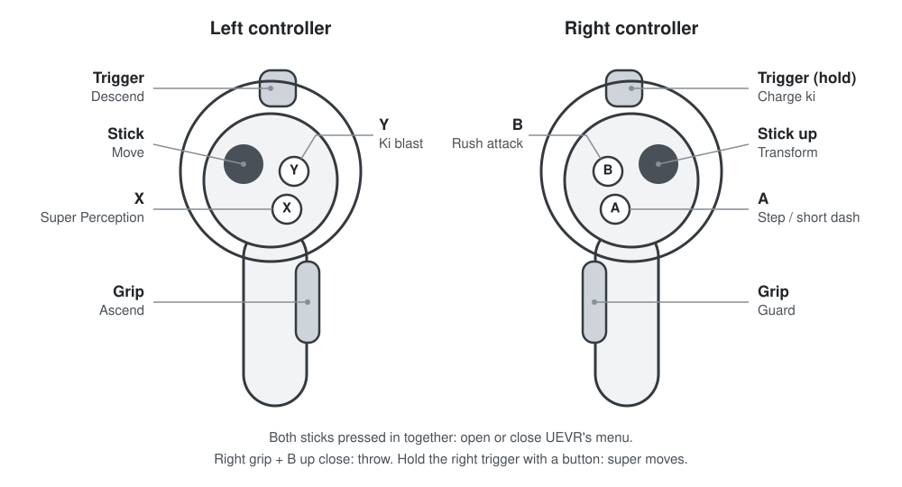

# Sparking! ZERO VR

A free VR mod for [DRAGON BALL Sparking! ZERO](https://store.steampowered.com/app/1790600/) on PC (Steam). Play it in first person, in VR: you see through your character's eyes, and your hands are their hands.

This is an early release, made for offline training matches. Every character works, and I'm polishing them one at a time, so there's more to come.

**Watch it:** [Goku vs Vegeta in first person](https://www.youtube.com/watch?v=0jGkB9DC5XU) on [YouTube](https://www.youtube.com/@pillowforge).

> **Offline only.** Bandai Namco has announced bans for mods in online play, so the mod switches itself off outside offline modes. Don't take it online.

**New to this?** Follow the steps below in order, or [let an AI assistant walk you through it](#set-it-up-with-an-ai-assistant).

---

## Will it work on my headset?

**This is not a standalone Quest app.** The game runs on your PC, and your headset works as the PC's screen. You need:

- **A gaming PC** that runs Sparking! ZERO well. VR is harder on a PC than a flat screen, so more power helps.
- **The game on Steam.** That's the version this is tested on. Other versions (like Game Pass) aren't tested.
- **A VR headset connected to that PC.**

| Headset | Works? |
| --- | --- |
| Quest 3 | Yes, tested with Virtual Desktop |
| Quest 3S, Quest 2, Quest Pro | Yes, connected to your PC the same way as a Quest 3 |
| Valve Index, Pico, Vive and other PC VR headsets | Should work, not tested |
| Any headset on its own, without a PC | No |

**Connecting a Quest to your PC:** this guide uses **Virtual Desktop** (a paid app on the Quest store), which is what the mod is tested with. Air Link, a Link cable and Steam Link should work too, but they aren't tested.

---

## What you need to download

1. **The mod:** `SparkingZERO-Win64-Shipping.zip` from the [Releases](../../releases) page.
2. **Unreal VR Easy Injector**, the app that puts the game in VR: the setup program from [its Releases page](https://github.com/oduis/UEVRDeluxe/releases) ([website](https://uevrdeluxe.org/)). Install it.

> Your antivirus may warn about the injector. That's expected: it works by joining itself to the game while it runs, which looks suspicious to antivirus software. Add an exception if it blocks it.

## Install the mod (once)

1. Open **File Explorer**, click its address bar, paste `%APPDATA%\UnrealVRMod` and press **Enter**. If Windows says the folder doesn't exist, open `%APPDATA%` the same way and make a new folder in it called `UnrealVRMod`.
2. **Right-click the mod's zip** and choose **Extract All…**
3. Set the folder it extracts to as `%APPDATA%\UnrealVRMod\SparkingZERO-Win64-Shipping`, exactly that name, and press **Extract**. Updating from an older version? Choose **Replace the files** when Windows asks. Your settings are kept.

That folder is the game's UEVR profile. Easy Injector and plain UEVR both read it.

## Play (every time)

1. **Put your headset on and connect it to your PC** (start Virtual Desktop and connect).
2. **Open Unreal VR Easy Injector on the PC** and click **DRAGON BALL: Sparking! ZERO** in its game list. If it isn't there, press **Rescan game library**.
3. **Choose OpenXR:** pick **OpenXR, linking via:** and check that it names Virtual Desktop. Click the name to change it.
4. **Press the start button at the bottom.** It starts the game and puts it in VR after a short wait.
5. **A menu floats in front of you.** That's UEVR's menu, and your controllers won't reach the game while it's open. **Close it by pressing both thumbsticks in at the same time.** Press them in again to open it any time.
6. **Start a training match:** Battle & Training → Super Training → Training. Pick any character. Goku (Super) is the most polished place to start.
7. **Stand or sit how you'll play, look straight ahead, and recenter:** open UEVR's menu (both sticks in), go to **VR → Runtime**, press **Recenter Horizon**, then **Set Standing Origin**, and close the menu.
8. **First time only, measure your arms** so your in-game arms match yours: open UEVR's menu, go to **LuaLoader → Script UI**, and press **Measure my arms**, in the position you play in.

---

## Controls

The buttons are the game's own Xbox controls, mapped onto your controllers.



| Your controller | What it does |
| --- | --- |
| Left **stick** | Move |
| Right **B** | Rush attack (punches and kicks) |
| Left **Y** | Ki blast |
| Right **A** | Step / short dash |
| Left **X** | Super Perception |
| Right **grip** | Guard |
| Left **grip** | Ascend |
| Left **trigger** | Descend |
| Right **trigger** (hold) | Charge ki. Hold it with another button for super moves, as on a gamepad |
| Right **grip** + right **B**, up close | Throw |
| Right **stick up** | Transform (below) |
| Both **sticks** pressed in | Open or close UEVR's menu |

**Transforming:** push the right stick up and hold it, and a ring of your character's forms appears. Point your right hand at a form and let go of the stick to transform into it. A quick flick up instead climbs one form.

---

## The mod's settings

Open UEVR's menu (both thumbsticks in) and go to **LuaLoader → Script UI**. Everything saves by itself.

**Turning**
- **Turning:** **Snap** turns in steps (more comfortable for most people), **Smooth** turns continuously.
- **Ultimates, Super moves, Transformations, Rush finishers:** **Off** keeps you in first person. **Game camera** switches to the game's own cinematic camera for those moments, so you can watch your character from outside.

**Picture**
- **Picture quality:** DLSS, for NVIDIA RTX graphics cards only. **Off** is the default. **DLAA** is the sharpest, **Performance** the fastest. Try **Quality** first.

**Arms**
- **Measure my arms:** matches your in-game arms to your real ones. Do it once, in the position you play in.
- **Clear view in rush combos:** hides the arm swipes that block your view during rush combos.

**Gestures**
- Optional, and all off to begin with. See [Gestures](#gestures-new-and-optional) below.

**Developer:** for testing. Leave it alone.

---

## Common questions

**What game is this?**
[DRAGON BALL Sparking! ZERO](https://store.steampowered.com/app/1790600/), Bandai Namco's Dragon Ball fighting game. This mod isn't a separate game: you need to own Sparking! ZERO on Steam, and the mod puts it in VR.

**Is this on the Quest store? Does it run on the Quest by itself?**
No. It's a PC mod: the game runs on your PC and your Quest shows it, connected with Virtual Desktop. See [Will it work on my headset?](#will-it-work-on-my-headset)

**Will it work on my Quest 3S / Quest 2 / Quest Pro?**
Yes, connected to a gaming PC, the same way as a Quest 3.

**Do I need a gaming PC?**
Yes. The PC does all the work, so it needs to run Sparking! ZERO well.

**Is it free?**
The mod is free. You need the game on Steam, and Virtual Desktop is a paid app on the Quest store.

**Can I play it online?**
No. It switches itself off outside offline modes, because mods online can get you banned.

**Can I play seated?**
Yes. Everything works on the buttons.

## Something's not right?

**My controllers do nothing in the game.**
UEVR's menu is open. Press both thumbsticks in to close it.

**My view is off to one side, or I'm too tall or short.**
Look straight ahead and recenter: UEVR's menu → VR → Runtime → Recenter Horizon, then Set Standing Origin.

**My arms are the wrong length, or my hands don't line up.**
UEVR's menu → LuaLoader → Script UI → Measure my arms, in the position you play in.

**The game starts flat, not in VR.**
Check that your headset was connected before you pressed start, and that Easy Injector is on OpenXR naming Virtual Desktop. If it still won't go into VR, try [plain UEVR](#prefer-plain-uevr) instead.

**Easy Injector says the UEVR backend "might not be compatible".**
The mod is tested on UEVR nightly 01143, and your Easy Injector has a different version. It may still work. If it doesn't, use [plain UEVR](#prefer-plain-uevr).

**Something else went wrong.**
Ask on the [Discussions](../../discussions) page. Say what you were doing and attach the newest log from `%APPDATA%\UnrealVRMod\SparkingZERO-Win64-Shipping\data\logs` (paste that into File Explorer's address bar).

---

## Gestures (new and optional)

Gestures let you make some moves with your real hands instead of a button. They're new, they're all off to begin with, and your buttons keep working either way, so you can ignore this section and play normally.

To try one, open the mod's settings (UEVR's menu → **LuaLoader → Script UI**), open **Gestures**, and turn it on. Make gestures standing up.

- **Punch:** punch forward with either hand for a rush attack.
- **Ki blast:** throw your hand forward to fire a ki blast from it.
- **Power up:** snap both hands down to your sides and hold them there to charge ki.
- **Ki super moves:** strike your character's pose for the move and hold it, like cupping your hands at your hip for a Kamehameha. Thrust your hands forward to fire. Only some characters have these so far: the Gestures menu lists which.

With Punch and Ki blast both on, **Punch or ki blast** picks how the mod tells them apart: by **wrist angle** (palm out is a ki blast, fist is a punch) or with **fixed hands** (right punches, left throws ki blasts).

**Not sure how a gesture goes? Do it the way you'd naturally do it.**

---

## Set it up with an AI assistant

Copy this whole message into any AI chat (ChatGPT, Claude, Gemini...) and it will walk you through the setup one step at a time, and help if you get stuck.

```text
Please walk me through installing and playing the Sparking! ZERO VR mod, one step at a time. Wait for me to say "done" before giving the next step. Start by asking me which headset I have and how I connect it to my PC, and adjust the steps to my answers. If something goes wrong, help me fix it before moving on. Use only the facts below; if I ask something they don't cover, say so rather than guessing.

FACTS ABOUT THE MOD
- It's a free VR mod for DRAGON BALL Sparking! ZERO on PC. It is not a standalone Quest app: the game runs on a gaming PC and the headset is the PC's screen.
- Needs: a gaming PC, the game on Steam (other versions aren't tested), and a PC VR headset. Quest 3 with Virtual Desktop is tested. Quest 3S, Quest 2 and Quest Pro work connected to the PC the same way. Air Link, a Link cable, Steam Link and other PC VR headsets should work but aren't tested.
- Offline only: the mod switches itself off outside offline modes, because mods online can get you banned.
- Downloads: the mod is SparkingZERO-Win64-Shipping.zip from https://github.com/pillowforge/SparkingZeroVR/releases. The injector is Unreal VR Easy Injector, the setup program from https://github.com/oduis/UEVRDeluxe/releases. Antivirus may flag the injector; that's expected, and an exception fixes it.

INSTALL (ONCE)
1. In File Explorer's address bar, open %APPDATA%\UnrealVRMod (make the UnrealVRMod folder in %APPDATA% if it doesn't exist).
2. Right-click the mod's zip, choose Extract All, and extract it to %APPDATA%\UnrealVRMod\SparkingZERO-Win64-Shipping (exactly that name). When updating, choose Replace the files; settings are kept.

PLAY (EVERY TIME)
1. Put the headset on and connect it to the PC (for Quest: start Virtual Desktop and connect).
2. Open Unreal VR Easy Injector and click DRAGON BALL: Sparking! ZERO in its game list (Rescan game library if it's missing).
3. Choose "OpenXR, linking via:" and check it names the headset's connection (Virtual Desktop for Quest). Click the name to change it.
4. Press the start button at the bottom. It starts the game and puts it in VR after a short wait.
5. A UEVR menu floats in view, and the controllers don't reach the game while it's open. Press both thumbsticks in together to close it (and again to open it).
6. Start a training match: Battle & Training, then Super Training, then Training. Goku (Super) is the most polished character to start with.
7. Look straight ahead and recenter: UEVR menu, VR, Runtime, Recenter Horizon, then Set Standing Origin.
8. First time only: UEVR menu, LuaLoader, Script UI, Measure my arms, in the position you play in.

CONTROLS (TOUCH CONTROLLERS)
Left stick move. Right B rush attack. Left Y ki blast. Right A step or short dash. Left X Super Perception. Right grip guard. Left grip ascend. Left trigger descend. Right trigger (hold) charge ki, and with another button super moves. Right grip and right B up close: throw. Right stick up: transform (hold it for a ring of forms and point at one, or flick it to climb one form).

THE MOD'S SETTINGS (UEVR MENU, LUALOADER, SCRIPT UI)
Turning: Snap or Smooth. Ultimates, Super moves, Transformations, Rush finishers: Off for first person, or Game camera for the game's cinematic camera. Picture quality: DLSS for NVIDIA RTX cards only (try Quality). Measure my arms. Clear view in rush combos. Gestures: optional hand motions, all off to begin with, made standing. Developer: for testing, leave it alone.

FIXES
Controllers do nothing: the UEVR menu is open; press both sticks in. View off to one side: recenter. Arms the wrong length: Measure my arms. Game starts flat: the headset must be connected before pressing start, and Easy Injector must be on OpenXR naming the right connection. Easy Injector warns the UEVR backend "might not be compatible": the mod is tested on UEVR nightly 01143; it may still work, and plain UEVR nightly 01143 is the fallback (get it from https://github.com/praydog/UEVR-nightly/releases, run UEVRInjector.exe, use Import Config with the mod's zip, answer Yes to the DLL warning, start the game, pick it in the list, choose OpenXR, press Inject). Anything else: ask on https://github.com/pillowforge/SparkingZeroVR/discussions with the newest log from %APPDATA%\UnrealVRMod\SparkingZERO-Win64-Shipping\data\logs.
```

---

## Prefer plain UEVR?

1. Get UEVR nightly 01143: on [praydog/UEVR-nightly releases](https://github.com/praydog/UEVR-nightly/releases), find "UEVR Nightly 01143", download `uevr.zip`, unzip it and run `UEVRInjector.exe`.
2. Click **Import Config** on the left and pick the mod's zip, still zipped, with its name unchanged. Answer **Yes** to the DLL warning: the DLLs are the mod's plugin and NVIDIA's DLSS. (This does the same as **Install the mod** above, so you only need one of the two.)
3. Start the game, pick it in the list at the top (if it isn't there, close UEVR and open it again), choose **OpenXR**, and press **Inject**.
4. Carry on from step 5 of **Play** above.

---

## Credits

- NVIDIA DLSS: the release ships NVIDIA's `nvngx_dlss.dll` (DLSS 310.9.16), unchanged, under NVIDIA's terms (`NVIDIA-DLSS-LICENSE.txt` in the zip). NVIDIA and DLSS are trademarks of NVIDIA Corporation.
- UEVR by praydog: the mod's plugin is built against UEVR's plugin API (MIT).
- Unreal VR Easy Injector by oduis.

## Disclaimer

Sparking! ZERO VR is an unofficial fan mod. It is not affiliated with, endorsed by or sponsored by Bandai Namco Entertainment, Toei Animation, Bird Studio/Shueisha or NVIDIA. DRAGON BALL and DRAGON BALL Sparking! ZERO belong to their owners. The code is MIT licensed (see `LICENSE`).
